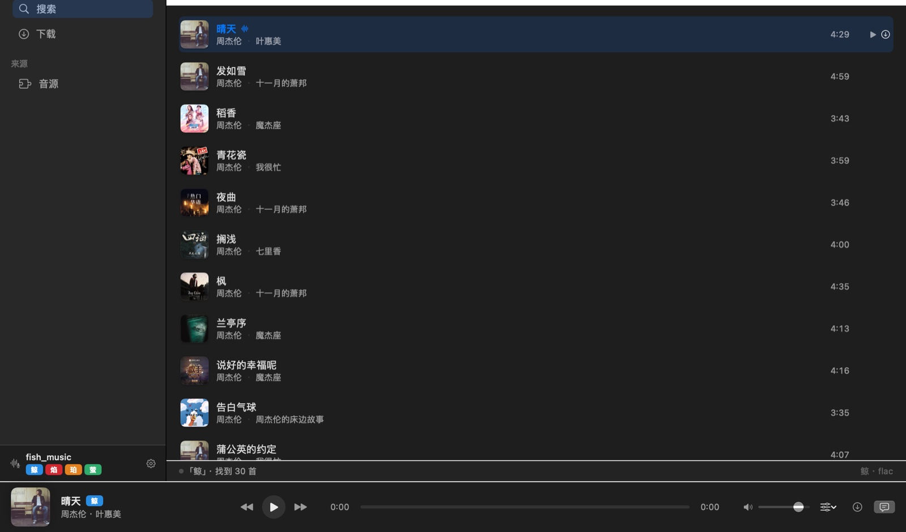

# Cadence · 韵律

**基于 [LX 音乐](https://github.com/lyswhut/lx-music-desktop) 生态的原生 macOS 音乐播放器** ——
用 SwiftUI + JavaScriptCore + AVAudioEngine 重写播放器，兼容 LX 音源脚本，去掉 Chromium。




<p align="center">
  
</p>

---

## 这是什么

一个能装进「应用程序」、关掉窗口还在菜单栏放歌的 macOS 播放器。
音源不是内置的：导入一份 LX 格式的 `.js` 音源脚本，它就能在四个来源之间搜索、播放、下载。

和 Electron 版本的区别只有一件事：**播放器本身是原生的**。

| | LX 音乐（洛雪） | Cadence |
|---|---|---|
| 渲染 | Chromium | SwiftUI |
| 音源脚本 | 定义 `lx` 协议 | 兼容同一份 `.js` |
| 内存 | 每音源一个渲染进程 | 每音源一个 `JSContext` |
| 打包 | Electron | 1.5 MB `.app`（arm64） |

## 特性

- **渐进流播放**：点下播放 0.5–0.6 秒出声，不等整首下完；缓冲不足自动暂停、够了继续
- **原生音频链**：`AVAudioPlayerNode → 10 段 EQ → 变速变调 → mixer`，保留 EQ 与 0.5–2.0x 变速
- **四平台**：搜索、取链、歌词；酷我没有歌词接口时自动用其它源补齐
- **下载**：可选音质、并发上限 3、失败重试；MP3 把**封面和歌词写进文件本身**（ID3v2.3），FLAC/M4A 落同名 `.lrc`/`.jpg`
- **桌面歌词**：无边框 `NSPanel`，非激活、全空间常驻、位置记忆、当前行高亮
- **菜单栏常驻**：关窗口不退出，菜单里能播放/切歌/唤回窗口
- **macOS 细节**：媒体键、控制中心进度可拖、`⌘1/2/3` 切栏、窗口与偏好记忆

## 安装

### 下载安装包（Apple Silicon）

1. 到 [Releases](https://github.com/vagtio/cadence/releases/latest) 下载 `Cadence-1.0.0-arm64.dmg`
2. 打开 DMG，把 Cadence 拖到旁边的 Applications
3. **首次打开若被系统拦截**：右键点 App → 打开（ad-hoc 签名，未公证）

或者一条命令解决拦截：

```sh
xattr -dr com.apple.quarantine /Applications/Cadence.app
```

要求 macOS 13 或更高，**Apple Silicon（M 系列）**。

### 从源码构建

```sh
git clone https://github.com/vagtio/cadence.git
cd cadence
./build-app.sh                 # 生成 .build/Cadence.app
open .build/Cadence.app
```

只需要 Swift 6 工具链（Command Line Tools 即可，无需完整 Xcode）。
App 图标由 `swift Tools/make-icon.swift` 生成，仓库里已带 `Resources/AppIcon.icns`。

## 首次使用：导入音源

Cadence **不分发音源脚本**。第一次打开是空态，需要一份 LX 格式的 `.js` 音源：

1. 侧栏「音源」→「从链接导入…」→ 粘贴脚本直链，回车
2. 或「导入脚本…」选择本地文件

脚本会被复制到 `~/Library/Application Support/Cadence/Sources/`，下次启动自动加载。
每个脚本在**独立的 `JSContext` + `JSVirtualMachine`** 里运行，不用 WebView，互相隔离。

界面里的四个来源用隐喻名，不出现上游品牌：

| 内部 | 显示 | 取意 |
|---|---|---|
| kg | 鲸 | 蓝色 · 曲库深 |
| wy | 焰 | 红色 · 热榜 |
| kw | 珀 | 橙色 · 琥珀 |
| tx | 萤 | 绿色 · 微光 |

## 快捷键

| 快捷键 | 动作 |
|---|---|
| `⌘F` | 聚焦搜索框 |
| 单击 / 双击列表行 | 选中 / 播放 |
| `空格` | 播放 / 暂停 |
| `⌘D` | 下载选中歌曲（未选中时下载正在播放的） |
| `⌘1` `⌘2` `⌘3` | 搜索 / 下载 / 音源 |
| `⌘⇧L` | 显示 / 隐藏桌面歌词 |
| `⌘0` | 从菜单栏唤回主窗口 |
| `⌘,` | 设置 |

## 架构

```text
音源脚本(.js) ──JavaScriptCore──▶ 播放地址
                                    │
酷狗/网易云/酷我/QQ 公开接口 ──▶ 搜索 · 歌词 · 封面
                                    │
                     URLSession 增量下载 ──▶ 临时文件（持续增长）
                                    │
        后台读循环重开文件、只读新增段 ──▶ PCM ──▶ playerNode
                                                    │
                              10 段 EQ ─▶ 变速 ─▶ mixer ─▶ 输出
```

| 目录 | 职责 |
|---|---|
| `Sources/LxSourceKit/` | 音源运行时：`LXEngine`（JSC + `lx` 桥 + crypto/buffer/zlib + 定时器） |
| `Sources/Cadence/AudioEngine.swift` | 渐进流、分段解码、EQ、变速 |
| `Sources/Cadence/Platforms.swift` | 四平台搜索 / 歌词 / 封面 |
| `Sources/Cadence/DownloadManager.swift` | 队列、并发、进度 |
| `Sources/Cadence/MetadataWriter.swift` | ID3v2.3 封面与歌词写入 |
| `Sources/Cadence/Views.swift` | SwiftUI 界面 |
| `Sources/Cadence/SelfTest.swift` | 无界面自检与截图 |
| `Sources/lxspike/` | 命令行验证器（Phase 0 的产物） |

## 实测

平台能力（真实接口，非 mock）：

| 平台 | 搜索 | 取链 | 歌词 | 封面 |
|---|---|---|---|---|
| 鲸 | ✅ | ✅ | ✅ | ✅ `album/info` |
| 焰 | ✅ | ✅ | ✅ | ✅ `song/detail` |
| 珀 | ✅ | ✅ | 跨源补齐 | 跨源匹配 |
| 萤 | ✅ 约 10 条 | ✅ | ✅ | 跨源匹配 |
| 咪咕 | ❌ 无匿名入口 | — | — | — |

一次完整链路（52.8 MB FLAC）：

```text
stream   started in 0.69 s  (est. duration 270 s, downloaded 1%)
playing  position 2.98 s  buffered through 20.0 s  downloaded 100%
seek     → 216 s (80%), now 216.8 s, buffering=no
download 周杰伦 - 晴天.flac  52.8 MB
```

内存（arm64 macOS 27，`--idle-probe`）：

| 场景 | RSS |
|---|---|
| 空转，未加载音源 | ~143 MB（SwiftUI/AppKit/AVFoundation 基线） |
| 加载 1 个 640 KB 音源 | ~150 MB，脚本定时器会让它缓慢增长 |
| 闲置后释放引擎 | 停止增长（不回落，macOS 不还页） |
| 播放中（无窗口自检） | 78–82 MB |

## 自检与开发

```sh
QMUSIC_SOURCE=<script.js> .build/Cadence.app/Contents/MacOS/Cadence --selftest
```

跑通「加载音源 → 搜索 → 取链 → 歌词 → 下载 → 解码 → 播放 → seek → 暂停」，任何一步失败非零退出。

其它用途：

| 参数 | 作用 |
|---|---|
| `--snapshot out.png` | 离屏渲染真实界面（主窗口 / 音源 / 下载 / 歌词浮窗 / 控件探针） |
| `--idle-probe` | 观察音源引擎的闲置释放与内存 |
| `--inspect file.mp3` | 用 AVFoundation 读回标签，验证内嵌封面与歌词 |
| `--window-test` | 验证「关窗不退出 + 菜单栏唤回」 |
| `--import-test <url>` | 验证链接导入与主线程阻塞时长 |
| `--cover-test` | 验证四个来源的封面取法 |

## 常见问题

**打不开，提示无法验证开发者？**
ad-hoc 签名、未公证（公证需要付费 Apple Developer 账号）。两种办法：

- 右键点 App → 打开 → 再点「打开」
- 或者 `xattr -dr com.apple.quarantine /Applications/Cadence.app`

只需处理一次，之后正常双击。

**导入音源后列表里没有？**
脚本初始化失败会被跳过（日志里有原因）。常见原因：脚本自身要先联网校验，或链接指向的不是 `.js`。
体积大的脚本（数百 KB）初始化可能要十几秒，页头会显示「正在初始化音源…」，这期间界面不会卡。

**萤（QQ 音乐）搜索结果很少？**
走的是匿名 smartbox 接口，上限约十条；完整搜索需要登录态 cookie，本项目不做账号体系。

**为什么没有咪咕？**
其搜索接口需要签名/JS 校验，没有可用的匿名入口。

**内存为什么比宣传的高？**
1. 基线 ~143 MB 来自 SwiftUI/AppKit/AVFoundation/MediaPlayer 本身；播放器省不掉。
2. 音源脚本是第三方代码，体积从 4 KB 到 640 KB 不等，会自己开定时器。
   闲置 90 秒（菜单栏模式 30 秒）会释放引擎，代价是下次播放多一次初始化。

**Intel Mac 能用吗？**
不能，只发布 Apple Silicon 构建（arm64）。

## 与上游 LX 音乐的关系

Cadence 把 LX 音乐当作**协议来源**，而不是代码来源：

- 音源脚本契约：`lx.EVENT_NAMES` / `lx.request` / `lx.on('request')` / `lx.send('inited')`、
  `lx.utils.{crypto,buffer,zlib}`、回应校验规则（URL ≤ 2048、`^https?:`、lyric/pic 结构）
- `musicInfo` 字段：按 `toOldMusicInfo` 的旧结构（`songmid` / `hash` / `rid` / `strMediaMid` /
  `copyrightId` / `albumId` …）构造，第三方脚本无需修改
- 交互借鉴：主备音源回退、独立的桌面歌词窗口、按平台分下载目录

本仓库**不包含**上述任何项目的源代码，也**不分发音源脚本**。上游以 Apache-2.0 发布，
本项目按派生作品处理，同样使用 Apache-2.0，详见 [LICENSE](./LICENSE) 与 [NOTICE](./NOTICE)。

## 路线图

- [ ] 曲库 / 歌单 / 播放历史（SQLite 持久化）
- [ ] seek 使用 Range 请求，拖动不必等顺序下载
- [ ] KRC 逐字歌词
- [ ] Developer ID 签名与公证

## 许可与致谢

- 代码：[Apache-2.0](./LICENSE)，派生关系见 [NOTICE](./NOTICE)
- 上游：[lyswhut/lx-music-desktop](https://github.com/lyswhut/lx-music-desktop)、
  [Nshpiter/Q-music](https://github.com/Nshpiter/Q-music)
- 音源脚本由第三方作者提供，本项目不分发；请遵守各平台服务条款与当地法律
